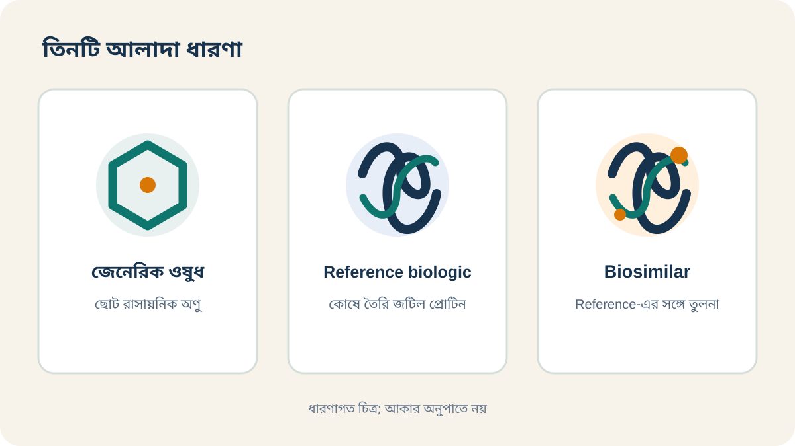
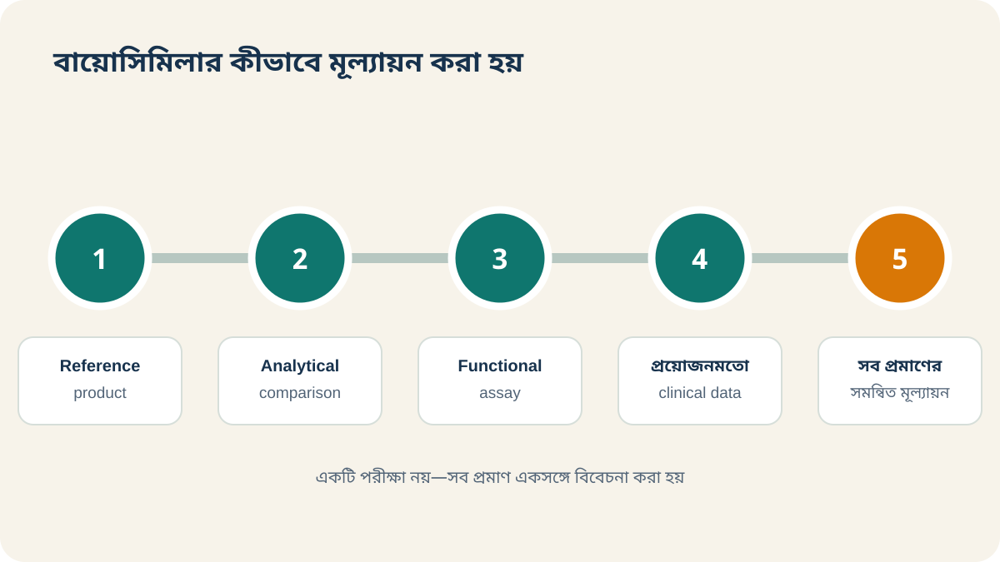
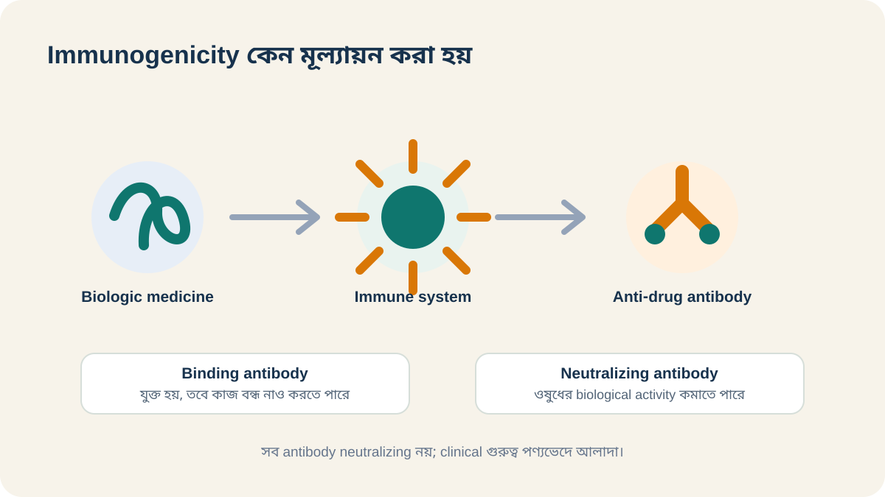

# বায়োসিমিলার কী? মূল বায়োলজিক ও জেনেরিক ওষুধ থেকে পার্থক্য কীভাবে বোঝা যায়

**সংক্ষেপে:** বায়োসিমিলার হলো এমন একটি জীবপ্রযুক্তিভিত্তিক ওষুধ, যেটিকে আগে অনুমোদিত একটি বায়োলজিক ওষুধের সঙ্গে তুলনা করে অত্যন্ত সাদৃশ্যপূর্ণ প্রমাণ করা হয়েছে। আগে অনুমোদিত ওষুধটিকে বলা হয় **রেফারেন্স প্রোডাক্ট**। বায়োসিমিলার সাধারণ জেনেরিক ওষুধের মতো হুবহু রাসায়নিক কপি নয়। কারণ বায়োলজিক ওষুধ জীবন্ত কোষ ব্যবহার করে তৈরি হয় এবং এর গঠন ও উৎপাদনপ্রক্রিয়া অনেক বেশি জটিল।

ডায়াবেটিস, ক্যানসার, প্রদাহজনিত রোগ, রক্তস্বল্পতা এবং বিভিন্ন ইমিউন-সম্পর্কিত রোগের চিকিৎসায় বায়োলজিক ওষুধ ব্যবহৃত হয়। বায়োসিমিলার কীভাবে পরীক্ষা করা হয় তা জানলে চিকিৎসক, ফার্মাসিস্ট ও রোগীরা “সাদৃশ্যপূর্ণ” এবং “একেবারে একই”—এই দুই ধারণার পার্থক্য বুঝতে পারবেন।

*লেখক: Sayedul Abrar, Pharmacist · সম্পাদকীয় খসড়া: ২৪ নভেম্বর ২০২৬*

*চিত্র ১। ধারণাগত তুলনা; অণুর আকার অনুপাতে নয়।*

## ১. বায়োলজিক বা জীবপ্রযুক্তিভিত্তিক ওষুধ কী?

বায়োলজিক ওষুধ সাধারণত জীবন্ত কোষ, অণুজীব বা অন্যান্য জৈবিক ব্যবস্থা ব্যবহার করে তৈরি করা হয়। এর মধ্যে অনেক ওষুধই প্রোটিন—যেমন ইনসুলিন, গ্রোথ ফ্যাক্টর, erythropoietin এবং monoclonal antibody।

একটি প্রোটিন ওষুধের কার্যকারিতা শুধু তার amino-acid sequence-এর ওপর নির্ভর করে না। এর ত্রিমাত্রিক গঠন, ভাঁজ, glycosylation বা sugar attachment, বিশুদ্ধতা, formulation এবং উৎপাদনপ্রক্রিয়াও গুরুত্বপূর্ণ। Cell line, culture condition, purification, storage এবং manufacturing control—সবকিছুই চূড়ান্ত পণ্যের বৈশিষ্ট্যকে প্রভাবিত করতে পারে।

একই reference biologic-এর বিভিন্ন batch-এও স্বাভাবিক সীমার মধ্যে কিছু পার্থক্য থাকতে পারে। তাই উৎপাদনকারী প্রতিষ্ঠান প্রতিটি অণু হুবহু একই হবে—এমন প্রত্যাশা করে না; বরং নির্ধারিত quality attribute ও specification-এর মধ্যে ধারাবাহিকতা বজায় রাখে। এর অর্থ এই নয় যে মানের যেকোনো পার্থক্য গ্রহণযোগ্য। অনুমোদিত সীমা ও মাননিয়ন্ত্রণ অবশ্যই বজায় রাখতে হয়।

## ২. বায়োলজিক, বায়োসিমিলার ও জেনেরিক—পার্থক্য কী?

| ধরন | সহজ অর্থ |
|---|---|
| Reference biologic | পূর্ণ quality, safety ও efficacy তথ্যের ভিত্তিতে প্রথম অনুমোদিত বায়োলজিক ওষুধ; এটিই বায়োসিমিলারের তুলনার ভিত্তি। |
| Biosimilar | Reference biologic-এর সঙ্গে অত্যন্ত সাদৃশ্যপূর্ণ প্রমাণিত জীবপ্রযুক্তিভিত্তিক ওষুধ, যার নিরাপত্তা ও কার্যকারিতায় clinically meaningful পার্থক্য নেই। |
| Generic medicine | সাধারণত রাসায়নিকভাবে তৈরি ছোট অণুর ওষুধ, যার active substance reference medicine-এর সঙ্গে একই হওয়ার কথা এবং উপযুক্ত pharmaceutical ও bioequivalence শর্ত পূরণ করতে হয়। |

একটি বায়োসিমিলারকে reference biologic-এর প্রতিটি অণুর হুবহু অনুলিপি হতে হয় না। বরং নির্দিষ্ট reference product-এর সঙ্গে সরাসরি ও বিস্তৃত তুলনা করে দেখাতে হয় যে অবশিষ্ট পার্থক্যগুলো ওষুধের মান, নিরাপত্তা বা কার্যকারিতায় clinically meaningful পরিবর্তন তৈরি করে না।

WHO স্পষ্টভাবে বলেছে, জটিল protein biosimilar অনুমোদনের ক্ষেত্রে সাধারণ জেনেরিক ওষুধের পদ্ধতি যথেষ্ট নয়।[১] “Similar” শব্দটি মানে “যেকোনো কাছাকাছি পণ্য” নয়। প্রয়োজনীয় comparability exercise সফলভাবে সম্পন্ন না হলে কোনো পণ্যকে biosimilar বলা উচিত নয়।

## ৩. কীভাবে বায়োসিমিলার প্রমাণ করা হয়?

*চিত্র ২। একটি পরীক্ষার ফল নয়, সম্পূর্ণ evidence package বিবেচনা করা হয়।*

এটি একটি পরিকল্পিত head-to-head comparability exercise। নিয়ন্ত্রক সংস্থা একটি পরীক্ষার ফল দেখে সিদ্ধান্ত নেয় না; বরং সব প্রাসঙ্গিক তথ্য একসঙ্গে বিবেচনা করে। একে বলা হয় **totality of evidence**।

### ধাপ ১ — Reference product নির্বাচন ও বোঝা

প্রথমে একটি উপযুক্ত, অনুমোদিত reference product নির্বাচন করা হয়। বাজারে থাকা একাধিক batch পরীক্ষা করে এর স্বাভাবিক quality profile ও variability বোঝা হয়। পুরো তুলনা একই নির্বাচিত reference product-কে ভিত্তি করে করতে হয়। অন্য দেশের reference product ব্যবহার করা হলে অতিরিক্ত bridging evidence লাগবে কি না, তা সংশ্লিষ্ট regulator নির্ধারণ করে।

### ধাপ ২ — গঠন ও গুণগত বৈশিষ্ট্য তুলনা

সংবেদনশীল analytical method দিয়ে amino-acid sequence, molecular mass, ত্রিমাত্রিক গঠন, charge variant, glycosylation pattern, purity, aggregate, degradation product এবং impurity পরীক্ষা করা হয়।

একটি পরীক্ষা দিয়ে সব বৈশিষ্ট্য বোঝা যায় না। তাই একাধিক পরিপূরক বা orthogonal analytical method ব্যবহার করা হয়। উদ্দেশ্য হলো পার্থক্য শনাক্ত করা, কেন পার্থক্য হয়েছে তা বোঝা এবং সেটি biological activity, stability, safety বা clinical performance-এ প্রভাব ফেলতে পারে কি না মূল্যায়ন করা।

কোনো পার্থক্য থাকলেই পণ্য বাতিল—এমন নয়। কিন্তু clinically relevant বৈশিষ্ট্যে ব্যাখ্যাতীত পার্থক্য থাকলে সেটি আরও তদন্ত করতে হয়।

### ধাপ ৩ — Biological function তুলনা

Functional assay পরীক্ষা করে অণুটি বাস্তবে কী কাজ করছে। পণ্যের ধরন অনুযায়ী receptor binding, enzyme activity, cell signalling, cell-based potency বা antibody-dependent function দেখা হতে পারে।

উদাহরণ হিসেবে, দুটি antibody-এর amino-acid sequence খুব কাছাকাছি হলেও কোনো structural feature-এর পার্থক্য receptor binding বা immune-cell function-এ প্রভাব ফেলতে পারে। Functional test এই পার্থক্যটি বাস্তবে গুরুত্বপূর্ণ কি না বুঝতে সাহায্য করে।

### ধাপ ৪ — Nonclinical ও clinical evidence

WHO-এর ২০২২ সালের নির্দেশিকায় product-specific বা case-by-case পদ্ধতির কথা বলা হয়েছে। Pharmacokinetic (PK) study দেখে শরীর ওষুধটিকে কীভাবে শোষণ, বণ্টন ও অপসারণ করে। Pharmacodynamic (PD) study উপযুক্ত biomarker থাকলে ওষুধের জৈবিক প্রভাব পরীক্ষা করে। প্রয়োজন অনুযায়ী immunogenicity মূল্যায়ন করা হয়।

যদি analytical, functional ও অন্যান্য প্রমাণে সাদৃশ্য যথেষ্টভাবে প্রতিষ্ঠিত হয়, তাহলে প্রতিটি পণ্যের জন্য বড় comparative efficacy trial স্বয়ংক্রিয়ভাবে বাধ্যতামূলক নয়। তবে যেখানে গুরুত্বপূর্ণ অনিশ্চয়তা থাকে, সেখানে অতিরিক্ত clinical efficacy বা safety data প্রয়োজন হতে পারে।[১,২]

এটি কম নিরাপত্তা-মানের অনুমোদন নয়। বরং একই প্রশ্নের উত্তর পেতে প্রয়োজনীয় প্রমাণকে বৈজ্ঞানিকভাবে সাজানো—বায়োসিমিলারটি reference product-এর তুলনায় যথেষ্ট সাদৃশ্যপূর্ণ কি না।

## ৪. Immunogenicity কেন গুরুত্বপূর্ণ?

*চিত্র ৩। সব antibody neutralizing নয়; clinical গুরুত্ব পণ্যভেদে আলাদা।*

Immunogenicity হলো কোনো biological medicine শরীরের immune system-কে প্রতিক্রিয়া জানাতে উদ্দীপিত করার ক্ষমতা। কোনো রোগীর শরীরে ওষুধটির বিরুদ্ধে anti-drug antibody (ADA) তৈরি হতে পারে। কিছু antibody ওষুধের সঙ্গে যুক্ত হলেও তার কাজ বন্ধ করে না; অন্য কিছু antibody ওষুধের biological activity neutralize করতে পারে।

পণ্যের ধরন ও রোগীর অবস্থার ওপর নির্ভর করে immune response ওষুধের শরীরে অবস্থান, কার্যকারিতা বা নিরাপত্তাকে প্রভাবিত করতে পারে। কখনো hypersensitivity বা অন্য adverse effect-ও দেখা দিতে পারে।

ঝুঁকি শুধু “biosimilar” শব্দটির ওপর নির্ভর করে না। Molecule, aggregate, impurity, expression system, formulation, excipient, container, administration route, dose, treatment duration এবং রোগীর নিজস্ব বৈশিষ্ট্য—সবকিছু বিবেচনা করতে হয়। WHO প্রতিটি পণ্যের জন্য আলাদা immunogenicity risk assessment এবং প্রয়োজন অনুযায়ী উপযুক্ত assay ও clinical sampling-এর পরামর্শ দেয়।[১]

Ji ও সহকর্মীদের ২০২৫ সালের একটি meta-analysis দেখিয়েছে, monoclonal antibody ও fusion protein biosimilar-এর ক্ষেত্রে pharmacokinetic similarity study থেকেও safety ও immunogenicity সম্পর্কে মূল্যবান তথ্য পাওয়া যায়। তবে এর অর্থ এই নয় যে সব বায়োসিমিলারের জন্য একই পরীক্ষার প্যাকেজ যথেষ্ট; পণ্যভেদে প্রমাণের ধরন নির্ধারণ করতে হয়।[৬]

## ৫. Biosimilar কি Reference biologic-এর সঙ্গে interchangeable?

এই শব্দগুলো এক নয়:

- **Switching:** চিকিৎসকের সিদ্ধান্তে রোগীকে reference biologic থেকে biosimilar-এ বা উল্টোভাবে পরিবর্তন করা।
- **Substitution:** prescriber-এর সঙ্গে আগে পরামর্শ না করে pharmacy থেকে একটি পণ্যের বদলে অন্যটি সরবরাহ করা।
- **Interchangeability:** বিভিন্ন দেশের নিয়ন্ত্রক ব্যবস্থায় আলাদা অর্থ ও শর্ত থাকতে পারে।

যুক্তরাষ্ট্রে FDA-এর আইনে “interchangeable biosimilar” নামে আলাদা একটি designation রয়েছে। Pharmacy-level substitution আবার অঙ্গরাজ্যের আইন অনুযায়ী নির্ধারিত হয়। FDA-অনুমোদিত biosimilar-এর এই অতিরিক্ত designation না থাকলেও সেগুলো reference product-এর মতোই নিরাপদ ও কার্যকর বলে বিবেচিত হয়।[৩]

ইউরোপীয় ইউনিয়নে EMA এবং Heads of Medicines Agencies ২০২২ সালে জানায় যে EU-তে অনুমোদিত biosimilar তার reference medicine অথবা একই reference-এর অন্য অনুমোদিত biosimilar-এর সঙ্গে interchangeable। তবে pharmacy-level substitution-এর সিদ্ধান্ত সদস্য রাষ্ট্রগুলোর নিজস্ব বিষয়।[৪]

এই নিয়ম অন্য দেশে সরাসরি প্রয়োগ করা যায় না। WHO বলেছে, interchangeability ও substitution-এর স্থানীয় নিয়ম নির্ধারণ করে সংশ্লিষ্ট দেশের National Regulatory Authority।[১] তাই রোগীর নিজের সিদ্ধান্তে biologic পরিবর্তন করা বা pharmacy-তে স্বয়ংক্রিয় substitution ধরে নেওয়া উচিত নয়।

২০২৩ সালের একটি systematic review ও meta-analysis-এ ২১টি biosimilar-এর ৩১টি study এবং ৫,২৫২ জন switch করা রোগীর তথ্য বিশ্লেষণ করা হয়েছিল। এতে পর্যালোচিত safety outcome-এ switch করা ও না-করা দলের মধ্যে অর্থবহ পার্থক্য পাওয়া যায়নি। তবে এটি সব পণ্য, সব রোগী বা সব switching pattern-এর জন্য একই ফল নিশ্চিত করে না; এটি কোনো দেশের substitution আইনও নির্ধারণ করে না।[৫]

## ৬. অনুমোদনের পরও নিরাপত্তা পর্যবেক্ষণ কেন চলতে থাকে?

অনুমোদন পাওয়ার পরও বিরল adverse event, দীর্ঘমেয়াদি প্রভাব, manufacturing change বা নির্দিষ্ট batch-সংক্রান্ত সমস্যা আরও স্পষ্ট হতে পারে। তাই WHO biosimilar-এর জন্য post-marketing pharmacovigilance, risk management এবং product traceability-কে গুরুত্ব দেয়।[১]

কোনো সন্দেহজনক সমস্যা রিপোর্ট করার সময় brand name, INN, manufacturer, batch বা lot number, dose, route, ব্যবহারের তারিখ এবং clinical event-এর তথ্য গুরুত্বপূর্ণ। এতে তদন্তকারীরা নির্দিষ্ট পণ্য শনাক্ত করতে পারেন। একটি রিপোর্ট সন্দেহ বা সতর্কতার কারণ তৈরি করে; সেটি একাই প্রমাণ করে না যে ওষুধটি সমস্যার কারণ।

এ বিষয়ে আরও পড়ুন: [Pharmacovigilance: How Are Medicines Monitored for Safety?](https://sayedulabrar.site/blog/pharmacovigilance-medicine-safety-monitoring/) এবং [Quality Assurance vs Quality Control](https://sayedulabrar.site/blog/quality-assurance-vs-quality-control/)।

## ৭. চিকিৎসক, ফার্মাসিস্ট ও রোগীর কী মনে রাখা উচিত?

১. প্রেসক্রিপশনে থাকা পণ্যের নাম, brand, strength, dosage form ও route নিশ্চিত করুন।
২. প্রতিটি পণ্যের নিজস্ব storage, preparation, administration ও device নির্দেশনা অনুসরণ করুন। দুটি পণ্যের device বা ব্যবহারপদ্ধতি একই ধরে নেবেন না।
৩. সম্ভব হলে biologic দেওয়ার সময় brand ও batch/lot number নথিভুক্ত করুন।
৪. Reference biologic থেকে biosimilar-এ পরিবর্তনের প্রস্তাব থাকলে চিকিৎসকের সঙ্গে কারণ ও পরিকল্পনা নিয়ে আলোচনা করুন।
৫. সন্দেহজনক adverse reaction বা product-quality concern যথাযথ জাতীয় reporting system-এ জানান। কারণ নিশ্চিত হওয়ার জন্য অপেক্ষা করবেন না।
৬. শুধু অনলাইন নিবন্ধ পড়ে কোনো biologic শুরু, বন্ধ বা পরিবর্তন করবেন না।

### বাংলাদেশে নিয়ন্ত্রক অবস্থার গুরুত্বপূর্ণ নোট

WHO Bangladesh-এর ২৭ সেপ্টেম্বর ২০১৮ তারিখের প্রতিবেদনে বলা হয়েছে, DGDA ২০১৮ সালে **Guideline for Registration of Biosimilar Products** চালু করেছিল।[৭] DGDA-এর প্রকাশিত Marketing Authorisation Guidelines তালিকায় **Guidelines for Registration of Biosimilar Products in Bangladesh 2025** শিরোনামের একটি নথিও রয়েছে। কিন্তু DGDA-এর ১৭ আগস্ট ২০২৫ তারিখের সংবাদ তালিকায় “Biosimilar Product Registration Guideline-2025” নামে একটি **খসড়া** নীতিমালা সম্পর্কে মতামত আহ্বানের নোটিশ রয়েছে।

পর্যালোচিত সরকারি পৃষ্ঠাগুলোতে ২০২৫ নথিটির চূড়ান্ত অনুমোদনের তারিখ, কার্যকর হওয়ার তারিখ বা ২০১৮ নির্দেশিকাকে আনুষ্ঠানিকভাবে প্রতিস্থাপন করেছে কি না—তা স্পষ্টভাবে উল্লেখ নেই। DGDA-এর ওয়েবসাইটে vaccine ও biosimilar পণ্যের registration-এর জন্য DGDA-RIMS-ও তালিকাভুক্ত রয়েছে।[৮]

এই তথ্যের ভিত্তিতে বর্তমান বাংলাদেশি approval pathway, interchangeability বা pharmacy-level substitution-এর অনুমতি সম্পর্কে এখানে কোনো চূড়ান্ত আইনি দাবি করা হচ্ছে না। কোনো আবেদন বা চিকিৎসা-সংক্রান্ত সিদ্ধান্তের আগে DGDA-এর কাছ থেকে প্রযোজ্য সর্বশেষ নির্দেশনা নিশ্চিত করা উচিত।

## সচরাচর জিজ্ঞাসা

### ১. Biosimilar কি generic medicine-এর মতো?

না। Generic medicine সাধারণত ছোট রাসায়নিক অণুর ওষুধ, যার active substance reference-এর সঙ্গে একই। Biosimilar হলো জটিল biological medicine, যাকে নির্দিষ্ট reference biologic-এর সঙ্গে বিস্তৃত তুলনা করে অত্যন্ত সাদৃশ্যপূর্ণ প্রমাণ করতে হয়।

### ২. Biosimilar হুবহু identical না হলে কি কম নিরাপদ?

না। অনুমোদিত biosimilar-কে regulator-এর নির্ধারিত উচ্চ similarity standard পূরণ করতে হয় এবং safety ও effectiveness-এ clinically meaningful পার্থক্য থাকা চলবে না। ক্ষুদ্র molecular difference থাকলে তার গুরুত্ব পরীক্ষা করা হয়।

### ৩. প্রতিটি biosimilar-এর কি বড় clinical efficacy trial লাগে?

সব ক্ষেত্রে নয়। Molecule, analytical ও functional result, অবশিষ্ট অনিশ্চয়তা এবং regulator-এর চাহিদার ওপর clinical evidence নির্ভর করে। PK/PD ও immunogenicity গুরুত্বপূর্ণ হতে পারে; comparative efficacy study প্রয়োজন অনুযায়ী নির্ধারিত হয়।

### ৪. Biosimilar কি immune response তৈরি করতে পারে?

যেকোনো biological medicine immune response তৈরি করতে পারে। মূল প্রশ্ন হলো reference product-এর তুলনায় biosimilar-এর immunogenicity অগ্রহণযোগ্যভাবে বেশি কি না এবং তা safety বা effectiveness-এ প্রভাব ফেলে কি না।

### ৫. Reference biologic থেকে biosimilar-এ পরিবর্তন করা যায়?

বিভিন্ন পণ্যের ক্ষেত্রে switching নিয়ে গবেষণা হয়েছে এবং সামগ্রিক প্রমাণ আশাব্যঞ্জক। তবু সিদ্ধান্তে নির্দিষ্ট পণ্য, রোগ, রোগীর অবস্থা, চিকিৎসকের পরিকল্পনা, traceability এবং স্থানীয় নিয়ম বিবেচনা করতে হবে।

### ৬. বাংলাদেশে কি সব biosimilar স্বয়ংক্রিয়ভাবে interchangeable?

এই খসড়ায় এমন দাবি করা হচ্ছে না। DGDA-এর প্রকাশিত তথ্য ২০১৮ সালের guideline, ২০২৫ সালের guideline listing এবং ২০২৫ সালের draft-consultation notice দেখায়। কিন্তু চূড়ান্ত আইনি অবস্থা ও স্থানীয় substitution rule DGDA-এর কাছ থেকে নিশ্চিত করা প্রয়োজন।

### ৭. Batch বা lot number কেন গুরুত্বপূর্ণ?

Biological medicine জটিল পণ্য এবং এগুলোর traceability জরুরি। Brand, manufacturer ও batch/lot number জানা থাকলে কোনো suspected adverse event বা quality concern নির্দিষ্ট পণ্যের সঙ্গে মিলিয়ে তদন্ত করা সহজ হয়।

## তথ্যসূত্র

১. World Health Organization. **Guidelines on evaluation of biosimilars.** WHO Technical Report Series No. 1043, Annex 3. ২০২২ সালের ৪–৮ এপ্রিল গৃহীত। [WHO-এর সরকারি নির্দেশিকা (PDF)](https://cdn.who.int/media/docs/default-source/biologicals/annex-3---who-guidelines-on-evaluation-of-biosimilars---sj-ik-5-may-2022.pdf)।
২. Kang HN, Wadhwa M, Knezevic I, Ondari C, Simao M. WHO guidelines on biosimilars: Toward improved access to safe and effective products. *Ann N Y Acad Sci.* 2023;1521(1):96–103. [doi:10.1111/nyas.14965](https://doi.org/10.1111/nyas.14965)।
৩. U.S. Food and Drug Administration. [Overview for Health Care Professionals: Biosimilars](https://www.fda.gov/drugs/biosimilars/overview-health-care-professionals) এবং [9 Things to Know About Biosimilars and Interchangeable Biosimilars](https://www.fda.gov/drugs/biosimilars/9-things-know-about-biosimilars-and-interchangeable-biosimilars)।
৪. European Medicines Agency and Heads of Medicines Agencies. [Biosimilar medicines can be interchanged](https://www.ema.europa.eu/en/news/biosimilar-medicines-can-be-interchanged)। ২০২২।
৫. Herndon TM, et al. Safety outcomes when switching between biosimilars and reference biologics: A systematic review and meta-analysis. *PLoS One.* 2023;18(10):e0292231. [doi:10.1371/journal.pone.0292231](https://doi.org/10.1371/journal.pone.0292231)।
৬. Ji P, et al. A meta-analysis of the safety and immunogenicity of pharmacokinetic similarity studies and comparative clinical studies. *J Clin Pharmacol.* 2025;65(4):499–507. [doi:10.1002/jcph.6165](https://doi.org/10.1002/jcph.6165)।
৭. WHO Bangladesh. [National Guideline on the Pharmacovigilance System in Bangladesh launched](https://www.who.int/bangladesh/news/detail/27-09-2018-national-guideline-on-the-pharmacovigilance-system-in-bangladesh-launched)। ২৭ সেপ্টেম্বর ২০১৮। এই প্রতিবেদনে DGDA-এর ২০১৮ সালের biosimilar registration guideline চালুর কথাও নিশ্চিত করা হয়েছে।
৮. Directorate General of Drug Administration, Bangladesh. [Marketing Authorisation Guidelines](https://dgda.gov.bd/pages/files/6922d9fd933eb65569e019d9); [DGDA News Listing](https://dgda.gov.bd/pages/news); [DGDA-RIMS for vaccine/biosimilar registration](https://mail.dgdagov.info/index.php/news/item/24-dgda-regulatory-information-management-system-dgda-rims-for-vaccine-biosimilar-product-online-regestration-system-launched)।

**শিক্ষামূলক ঘোষণা:** এই নিবন্ধটি সাধারণ জ্ঞান ও শিক্ষার জন্য। এটি কোনো নির্দিষ্ট পণ্যের prescribing guide নয়, ব্যক্তিগত চিকিৎসা-পরামর্শের বিকল্প নয় এবং বাংলাদেশের registration requirement সম্পর্কে আইনি ব্যাখ্যাও নয়। অনুমোদিত product information, চিকিৎসকের নির্দেশনা এবং সংশ্লিষ্ট regulator-এর সর্বশেষ নির্দেশনা অনুসরণ করুন।
